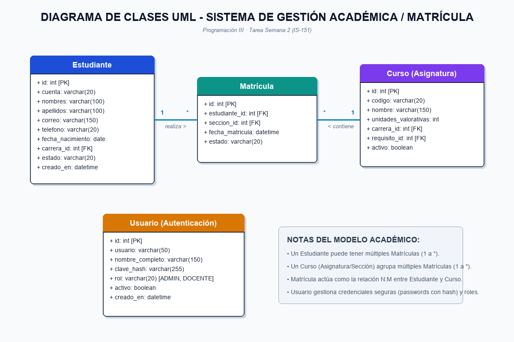

# Tarea Semana 2 · API de Matrícula
**Programación III (IS-151) — Universidad Politécnica de Honduras**

Sistema de gestión académica y matrícula modularizado con FastAPI, SQLite, frontend web integrado y cliente de escritorio con Tkinter.

---

## 📌 Contenido de la Entrega

1. **Tarea 1 - Repositorio en GitHub**: `matricula-api-caballero`
2. **Tarea 2 - Diagrama de Clases UML**: Archivo `uml.png` (Usuario, Estudiante, Curso, Matrícula).
3. **Tarea 3 - Modularización de la API**:
   - `database.py`: Conexión y creación de tablas SQLite.
   - `seguridad.py` / `routers/auth.py`: Hashing de contraseñas y autenticación.
   - `schemas.py`: Modelos y validaciones Pydantic.
   - `routers/`: Módulos de rutas con `APIRouter()` (`estudiantes.py`, `matriculas.py`, `carreras.py`, `secciones.py`, etc.).
   - `main.py`: Punto de entrada limpio que monta los routers y el frontend.
4. **Reto Opcional (+2 Puntos)**:
   - Endpoint implementado: `GET /api/v1/estudiantes/{id}/matriculas` que lista todos los cursos y secciones matriculadas de un estudiante con horarios, aulas y docentes.

---

## 📊 Diagrama UML



---

## 🚀 Cómo ejecutar la API

1. Crear y activar el entorno virtual e instalar requerimientos:
   ```bash
   cd API_Sistema_Academico_FastAPI_SQLite
   python -m venv venv
   venv\Scripts\activate
   pip install -r requirements.txt
   ```

2. Iniciar el servidor:
   ```bash
   uvicorn main:app --reload
   ```

3. Accesos:
   - **Frontend Web (Login + Dashboard):** http://127.0.0.1:8000
   - **Documentación Swagger:** http://127.0.0.1:8000/docs
   - **Usuarios de prueba:** `admin` / `admin123`  |  `docente` / `docente123`

---

## 🧪 Pruebas automáticas

```bash
python -m pytest -q
```
Todas las pruebas (13/13) pasan satisfactoriamente.
